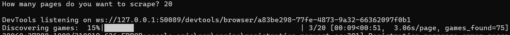
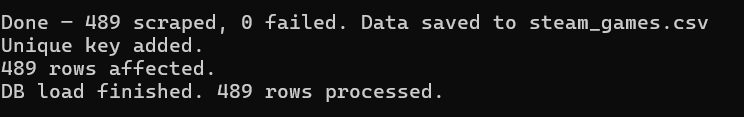
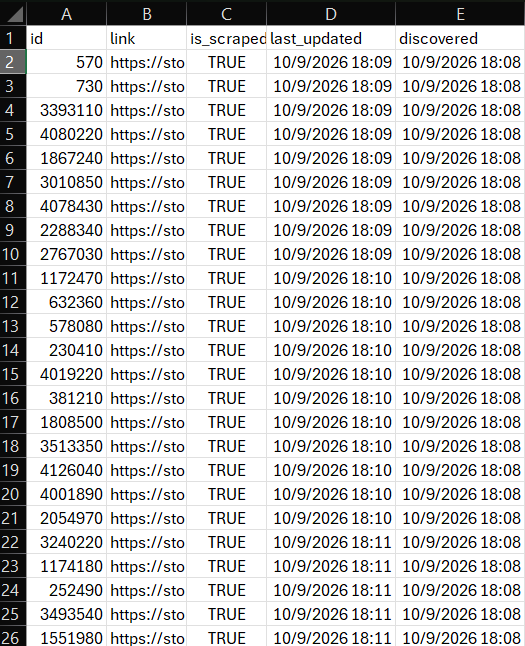
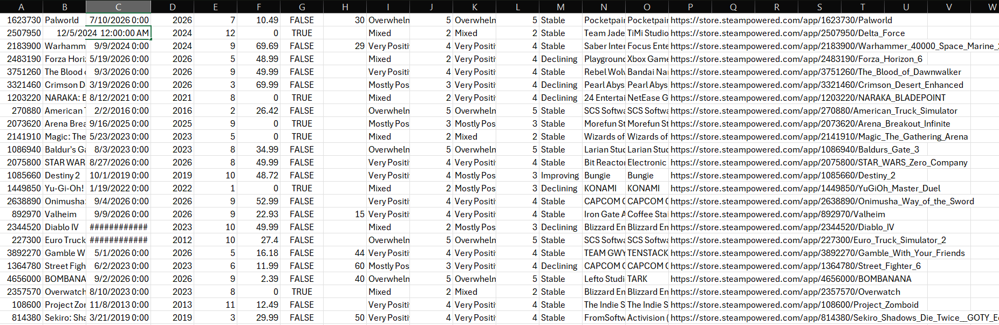

# Steam Games Scraper Pipeline

A three-stage pipeline that discovers games on the Steam store, scrapes each game's detail page, cleans the data, and loads it into MySQL.

```
Steam search pages ──► crawler.py ──► games_index.csv
                                          │
                                          ▼
Steam game pages  ──► scraper.py  ──► steam_games.csv
                                          │
                                          ▼
                    database_loader.py ──► MySQL (steam_games table)
```

> **SCREENSHOT:** 


 

---

## Features

- **Resumable:** the index CSV tracks every game as `False` / `True` / `Skipped`, so you can stop and restart without losing progress.
- **Deduplicated:** the crawler skips app IDs it has already seen; the DB loader upserts on `App_ID`.
- **Checkpointing:** scraped data is saved every 25 games.
- **Self-healing browser:** restarts Chrome if the session dies and every 300 games.
- **Handles age gates and cookie banners** automatically.
- **Derived columns:** price, discount, release year/month, review score (0–5), and review trajectory (Improving / Declining / Stable).

---

## Project Structure

```
.
├── main.py              # Entry point, runs all stages with CLI flags
├── crawler.py           # Stage 1: discover game links -> games_index.csv
├── scraper.py           # Stage 2: scrape detail pages -> steam_games.csv
├── database_loader.py   # Stage 3: load CSV into MySQL
├── requirements.txt   
├── .env                 
├── .gitignore
├── data/                
│   ├── games_index.csv
│   └── steam_games.csv
└── docs/
    └── screenshots/     
```

---

## Requirements

- Python 3.9+
- Google Chrome installed (Selenium 4.6+ downloads the matching driver automatically)
- MySQL 8.x (only needed for Stage 3)

### Install

```bash
python -m venv venv
source venv/bin/activate        # Windows: venv\Scripts\activate
pip install -r requirements.txt
```

`requirements.txt`:

```
selenium
pandas
numpy
tqdm
mysql-connector-python
python-dotenv
```

---

## Database Setup

1. Create the database:

```sql
CREATE DATABASE steam_games_data;
USE steam_games_data;
```

2. Create the table (column names must match the INSERT in `database_loader.py`; adjust types if you like):

```sql
CREATE TABLE steam_games (
    id                    INT AUTO_INCREMENT PRIMARY KEY,
    App_ID                INT,
    Game_Name             VARCHAR(255),
    Released_Date         DATE,
    Release_Year          INT,
    Release_Month         INT,
    Price_USD             DECIMAL(10,2),
    Is_Free               BOOLEAN,
    Discount              DECIMAL(5,2),
    Recent_Reviews        VARCHAR(50),
    Recent_Reviews_Score  DECIMAL(3,1),
    All_Reviews           VARCHAR(50),
    All_Reviews_Score     DECIMAL(3,1),
    Review_Trajectory     VARCHAR(20),
    Developer             VARCHAR(255),
    Publisher             VARCHAR(255),
    Link                  VARCHAR(500)
);
```

The loader adds `UNIQUE KEY (App_ID)` itself on first run, which is what makes re-runs update rows instead of duplicating them.

3. Create a `.env` file in the project root:

```env
DB_HOST=127.0.0.1
DB_USER=root
DB_PASSWORD=your_password_here
DB_NAME=steam_games_data
```


> **SCREENSHOT:** 

---

## Usage

### Run everything

```bash
python main.py --pages 10
```

If you omit `--pages`, you'll be prompted for it.

### Common recipes

| Goal | Command |
|---|---|
| Full pipeline, 10 search pages | `python main.py --pages 10` |
| Crawl only (no scraping, no DB) | `python main.py --pages 20 --skip-scrape --skip-db` |
| Scrape existing index only | `python main.py --skip-crawl --skip-db` |
| Load existing CSV into MySQL only | `python main.py --skip-crawl --skip-scrape` |
| Watch the browser work | `python main.py --pages 2 --show-browser` |
| Persist age-gate/cookie session | `python main.py --skip-crawl --user-data-dir ./chrome_profile` |

### CLI flags

| Flag | Default | Description |
|---|---|---|
| `--pages` | prompt | Number of search-result pages to crawl |
| `--index-csv` | `games_index.csv` | Link index file |
| `--output-csv` | `steam_games.csv` | Scraped data file |
| `--skip-crawl` | off | Skip Stage 1 |
| `--skip-scrape` | off | Skip Stage 2 |
| `--skip-db` | off | Skip Stage 3 |
| `--show-browser` | off | Run Chrome with a visible window |
| `--user-data-dir` | none | Chrome profile dir for the scraper stage |
| `--log-file` | `steam_pipeline.log` | Log file path |


---

## Data

### `games_index.csv` (Stage 1 output)

| Column | Description |
|---|---|
| `id` | Steam app ID |
| `link` | Store page URL |
| `is_scraped` | `False` (pending), `True` (done), `Skipped` (not a game / no name found) |
| `last_updated` | UTC timestamp of last scrape |
| `discovered` | UTC timestamp when the crawler found it |

### `steam_games.csv` (Stage 2 output)

| Column | Description |
|---|---|
| `App ID` | Steam app ID |
| `Game Name` | Name with ™ ® © stripped |
| `Release Date` / `Release Year` / `Release Month` | Parsed release date |
| `Price (USD)` / `Is Free` / `Discount (%)` | Numeric price, free flag, discount percent |
| `Recent Reviews` / `Recent Reviews Score` | Text label and 0–5 score |
| `All Reviews` / `All Reviews Score` | Text label and 0–5 score |
| `Review Trajectory` | `Improving`, `Declining`, or `Stable` (recent vs. all-time) |
| `Developer` / `Publisher` | Studio names |
| `Link` | Store page URL |

Review score scale: Overwhelmingly Positive = 5, Very Positive = 4, Mostly Positive = 3, Mixed = 2, Mostly Negative = 1, Overwhelmingly Negative = 0.

>-

> **SCREENSHOT:** 



---

## How It Works

1. **Crawler** opens Steam search results (games only, `category1=998`), collects every `a.search_result_row` link, extracts the app ID, and appends new ones to the index. 2-second delay between pages.
2. **Scraper** loops over index rows marked `False`, opens each page, passes the age gate, extracts name, date, price, discount, reviews, developer and publisher, then cleans everything with pandas. Pages with no game name are marked `Skipped`.
3. **Loader** reads the CSV, normalizes dates, converts NaN to `NULL`, and runs `INSERT ... ON DUPLICATE KEY UPDATE`.

---

## Logs

- `scraper.log` / `steam_pipeline.log`: progress, skipped games, errors. Check these first when something fails.

---

## Troubleshooting

| Problem | Fix |
|---|---|
| `selenium.common.exceptions.SessionNotCreatedException` | Update Chrome, or update Selenium (`pip install -U selenium`) |
| Crawler stops early with a timeout warning | Steam throttled or changed markup; re-run, it resumes from the index |
| Many games `Skipped` | Age gate or region block; try `--show-browser` and `--user-data-dir` |
| `Access denied for user` (MySQL) | Check `.env` credentials |
| `Table 'steam_games' doesn't exist` | Run the `CREATE TABLE` above |

---

## Limitations

- Steam changes its HTML periodically; CSS selectors may need updating.
- Prices are parsed as numbers from whatever currency Steam shows for your region. The column is labeled USD, so verify your region shows USD.
- Scraping is slow by design (one browser, sequential). Respect Steam's terms of service and don't hammer the site.

---

## Author

Ola Al-Dalahmeh
